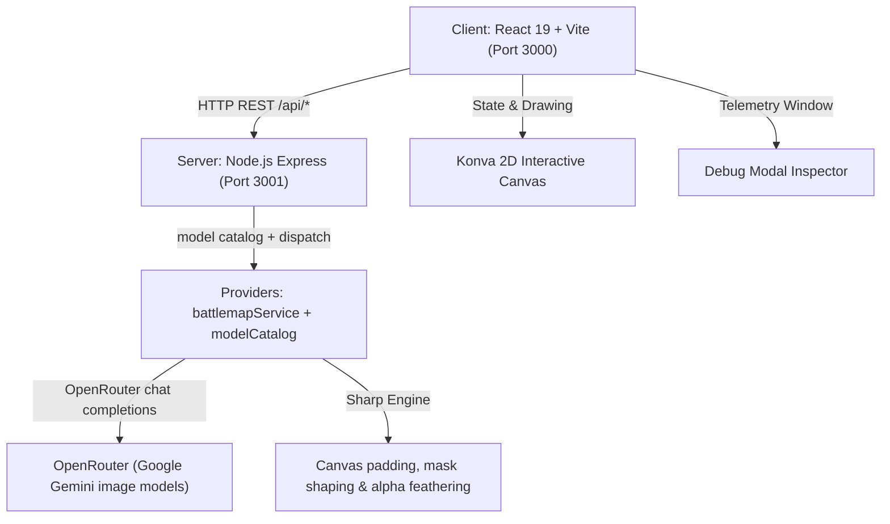

# AGENTS.md — Developer & AI Agent Guidelines for DUNGEON FORGE

Welcome to **DUNGEON FORGE**, an AI-powered 2D Tabletop RPG Battlemap Builder web application designed for games like Dungeons & Dragons (D&D 5e) and Pathfinder.

This document serves as the primary guidance file for AI agents and human developers working in this codebase.

---

## 1. Project Overview & Architecture

DUNGEON FORGE allows dungeon masters and players to generate 2D top-down battlemaps from text descriptions, edit details via canvas mask inpainting, and extend map boundaries infinitely in 4 cardinal directions (North, South, East, West) with soft alpha seam feathering.



---

## 2. Tech Stack

### Frontend (`/client`)
- **Framework**: React 19 + Vite 6
- **Styling**: TailwindCSS v4 (Space Grotesk & Plus Jakarta Sans typography, sleek dark glassmorphism)
- **Canvas Rendering**: `react-konva` & `konva` for 2D pan/zoom, right-drag mask painting, and edge expansion hotspots
- **Icons & Effects**: `lucide-react`, `canvas-confetti`

### Backend (`/server`)
- **Runtime & Server**: Node.js & Express (`PORT=3001`)
- **AI SDK**: OpenRouter's `chat/completions` REST API (`fetch`) — the only provider
- **Map Models**: every model renders raster pixels directly (the `image` output contract); the reply IS the image and is resized to the canvas size. There is no SVG contract. The full list, with measured behaviour and prices, lives in `server/services/modelCatalog.js`.
- **Image Processing**: `sharp` for canvas expansion, mask shaping, and 48px Gaussian blurred `dest-in` alpha mask composite feathering

---

## 3. Environment & Configuration

- **Environment Setup**: Server configuration is stored in `server/.env`:
  ```env
  PORT=3001
  OPENROUTER_API_KEY=sk-or-v1-...
  ```
  The key may also be supplied through the process environment; a key present in the environment satisfies the provider.
- **API Key Management**: The backend server centrally authenticates requests using `process.env.OPENROUTER_API_KEY`. **Do not reintroduce client-side API key configuration modals or localStorage key overrides.** `/api/health` reports `providers.openrouter`.
- **Model Selection**: The model is configured **backend-side only**, in `server/services/modelCatalog.js`: `DEFAULT_MODEL_ID` names the entry every request runs (`google/gemini-3.1-flash-image`), with the rest of `MODEL_CATALOG` kept as documented alternatives. The client never names a model and there is no model API or picker to reintroduce; switching engines is a one-line change to `DEFAULT_MODEL_ID`.

---

## 4. Repository Directory Structure

```
Battlemap Builder/
├── AGENTS.md                  # Project documentation & agent guidelines
├── package.json               # Root scripts & concurrently launcher
├── client/                    # Vite React Frontend
│   ├── src/
│   │   ├── components/
│   │   │   ├── BattlemapCanvas.jsx # Interactive Konva 2D canvas layer
│   │   │   ├── DebugModal.jsx      # Prompt & telemetry debug inspector
│   │   │   ├── Navbar.jsx          # Header navigation bar & global actions
│   │   │   ├── PromptHero.jsx      # New-map screen: the prompt, nothing else
│   │   │   ├── ActionModal.jsx     # Shared prompt modal for edit + expansion
│   │   │   └── BattlemapCanvas.jsx # Interactive Konva 2D canvas
│   │   ├── services/
│   │   │   └── api.js             # HTTP REST API client
│   │   ├── utils/
│   │   │   └── format.js          # Shared mm:ss timer formatting
│   │   ├── App.jsx                 # Main state manager & history stack
│   │   └── index.css              # Design tokens, glassmorphism & animation utilities
│   └── package.json
└── server/                    # Node Express Backend
    ├── index.js               # Express routes (/api/generate, /api/inpaint, /api/outpaint, /api/health)
    ├── services/
    │   ├── battlemapService.js    # Orchestrator: configured model, compositing, failure shape
    │   ├── modelCatalog.js        # Backend model configuration (provider, vision, cost notes)
    │   ├── prompts.js             # IMAGE_PROMPTS + builder functions
    │   ├── failure.js             # Upstream error summarising + user-facing failure sentences
    │   ├── imageProcessor.js      # Sharp directional canvas expansion & alpha seam feathering
    │   └── providers/
    │       └── openrouterProvider.js  # OpenRouter chat completions (image contract)
    └── .env                   # Server environment & API key
```

---

## 5. Development & Build Commands

Always execute commands from the project root directory `/home/knut/projects/Battlemap Builder`:

|Task|Command|Description|
|:---|:---|:---|
|**Start Dev Environment**|`npm run dev`|Runs Express server (`3001`) & Vite client (`3000`) concurrently|
|**Start Server Only**|`npm run dev:server`|Runs `node server/index.js`|
|**Start Client Only**|`npm run dev:client`|Runs Vite dev server inside `client/`|
|**Build Frontend**|`cd client && npm run build`|Compiles Vite production bundle|

---

## 6. Core Features & Implementation Details

### A. Initial Map Generation (`GENERATE`)
- `battlemapService.generateBattlemap()` runs the model `modelCatalog.js` is configured with, then assembles the payload from `IMAGE_PROMPTS.GENERATE`.
- The model returns raster bytes directly; the provider resizes them to the requested canvas size.
- The configured model is the only map producer. When its provider key is missing or the model returns no usable image, the error carries `code` + `telemetry` (prompts, model attempt trail, raw response, usage/cost); routes forward it with `400`/`502`/`503` and the client raises the loud failure banner. Never reintroduce a procedural/mock fallback.

### B. Canvas Outpainting & Seam Feathering (`OUTPAINT`)
- `prepareOutpaintCanvas()` in `imageProcessor.js` computes new target dimensions for directions (`north`, `south`, `east`, `west`, `all`).
- The model receives the padded canvas (`extendedImage`) so it can see the region to fill.
- `featheredOutpaintComposite()` applies a 48px Gaussian-blurred alpha mask (`dest-in`) along the boundary seam so extended terrain transitions smoothly into the original canvas without harsh edge cuts.

### C. Model Telemetry Inspector (`DebugModal.jsx`)
- Togglable via **Debug Logs** button in the header bar.
- Records structured telemetry for every request, including failed ones (`status: 'failed'`):
  1. **System Prompt (`IMAGE_PROMPTS`)**: Exact defined system directives.
  2. **User Request Prompt**: User input prompt.
  3. **Full Combined Payload**: Full prompt payload dispatched to model API.
  4. **Raw Model Response**: Exact text response (image-contract replies note that the image bytes are omitted).
- The inspector also shows the provider, the model actually used, token counts and the per-call cost reported by OpenRouter.
- Every failure also raises the dismissible rose banner in `App.jsx` (`failure` state) with the error `code`, the actionable message, the provider/model, and the per-model attempt trail; `reportFailure()` writes the same data into the debug logs. Nothing is captured for failures that never reached a model (missing key, unreachable backend): those logs say so instead of showing a fabricated prompt.

### D. Canvas Interactions — there is no sidebar (`PromptHero.jsx`, `BattlemapCanvas.jsx`, `ActionModal.jsx`)
- **New map**: with no map loaded, `PromptHero` shows only the prompt field and Generate (plus a forging state while the model runs).
- **Konva 2D Stage**: Pan (Shift + Drag / Middle Click) & Zoom (10% - 500%); maps auto-fit to the viewport on load.
- **Layers**: Background map, painted edit mask, generation/outpaint shimmer target region, edge expansion hotspots.
- **Edit**: right-click drag paints the mask; releasing opens the prompt modal, and only a stroke that actually painted points opens it. Cancel discards the mask; the request composites only the masked bounding box.
- **Expand**: the `+` hotspots around the canvas open the prompt modal for that direction. Hotspots are Konva `Circle`s — the radius attr is `radius` (not `r`), and `perfectDrawEnabled={false}` keeps the shadow out of Konva's offscreen buffer path.
- The grid overlay was removed entirely; do not reintroduce grid state, layers or controls.

---

## 7. Guidelines for AI Agents Modifying Code

1. **Aesthetics & UI Standard**:
   - Maintain the dark glassmorphic UI and the design tokens in `client/src/index.css` (`panel-card`, `btn-*`, `field`, `glass-panel`).
   - Use Tailwind v4 classes and predefined color tokens (`amber` for generate, `cyan` for edit, `emerald` for expand).
2. **Speed & Token Optimization**:
   - All system instructions are kept concise; image models choose their own render resolution, so the payload only states the required output pixel dimensions.
3. **Prompt Integrity**:
   - All system instructions live in `server/services/prompts.js` (`IMAGE_PROMPTS` for generation, inpaint and outpaint). Changing directives means changing them there only; the client renders whatever telemetry the server sends and shows an explicit "not captured" note when a request never reached a model.
4. **Model Catalog Integrity**:
   - Every model entry in `server/services/modelCatalog.js` must carry capabilities that were actually verified: `vision` and the parent provider. `DEFAULT_MODEL_ID` names the one the backend runs.
   - Masked edits require `vision`: `inpaintBattlemap()` refuses a non-vision configured model with `MODEL_NOT_VISION_CAPABLE` (HTTP 400) before any upstream call. Never point `DEFAULT_MODEL_ID` at a model that cannot receive images.
5. **No Silent Fallbacks**:
   - If the configured model fails, the request fails: the API returns `{ error, code, debug }` (400 misconfiguration, 502 upstream failure, 503 missing key) and the UI shows the banner. Never substitute procedural/mock imagery, silently switch to a different model, or return the unedited source image as if the request had succeeded.
6. **Verification**:
   - Always run `cd client && npm run build` to verify clean compilation after making frontend changes.
   - Provider work must be verified against the live API: the image generation path, the masked-edit path and the canvas-extension path — and the inpaint compositor must still leave 0 pixels changed outside the mask bounding box.
   - Canvas work must be verified in a real browser: right-drag painting opens the edit modal, a `+` hotspot opens the expansion modal, and the Konva layer canvases are free of uncaught draw errors.
