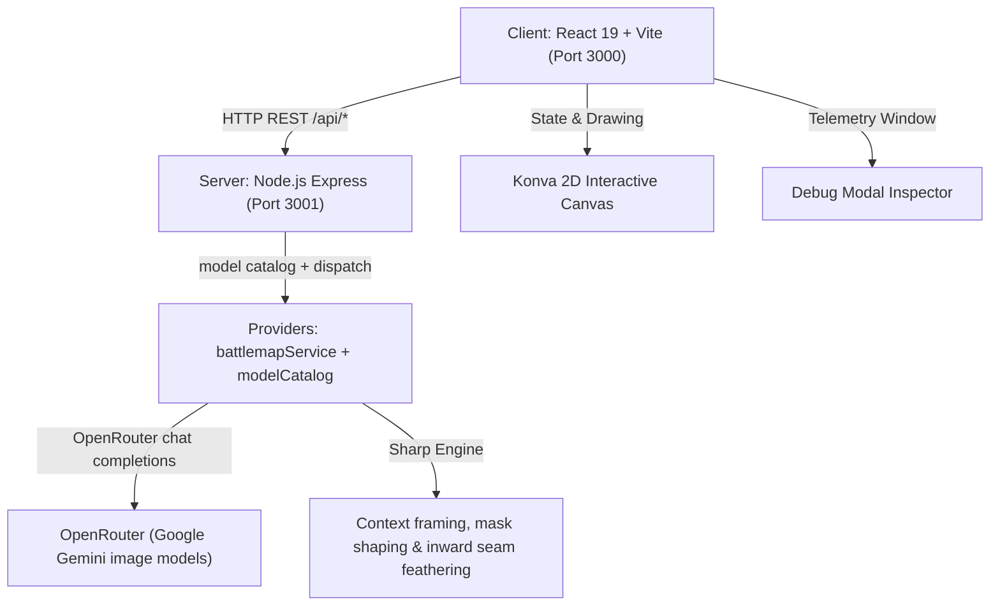

# AGENTS.md — Developer & AI Agent Guidelines for DUNGEON FORGE

Welcome to **DUNGEON FORGE**, an AI-powered 2D Tabletop RPG Battlemap Builder web application designed for games like Dungeons & Dragons (D&D 5e) and Pathfinder.

This document serves as the primary guidance file for AI agents and human developers working in this codebase.

---

## 1. Project Overview & Architecture

DUNGEON FORGE allows dungeon masters and players to generate 2D top-down battlemaps from text descriptions, edit details, and extend map boundaries seamlessly via 64px grid-snapped region forging with soft inward seam feathering.



---

## 2. Tech Stack

### Frontend (`/client`)
- **Framework**: React 19 + Vite 6
- **Styling**: TailwindCSS v4 (Space Grotesk & Plus Jakarta Sans typography, sleek dark glassmorphism)
- **Canvas Rendering**: `react-konva` & `konva` for 2D pan/zoom, 64px grid-snapped region selection, and handle resizing
- **Icons & Effects**: `lucide-react`, `canvas-confetti`

### Backend (`/server`)
- **Runtime & Server**: Node.js & Express (`PORT=3001`)
- **AI SDK**: OpenRouter's `chat/completions` REST API (`fetch`) — the only provider
- **Map Models**: every model renders raster pixels directly (the `image` output contract); the reply IS the image and is resized to the canvas size. There is no SVG contract. The full list, with measured behaviour and prices, lives in `server/services/modelCatalog.js`.
- **Image Processing**: `sharp` for context framing, binary mask shaping, and 20px inward seam feathering with strict boundary clipping

---

## 3. Environment & Configuration

- **Environment Setup**: Server configuration is stored in `server/.env`:
  ```env
  PORT=3001
  OPENROUTER_API_KEY=sk-or-v1-...
  ```
  The key may also be supplied through the process environment; a key present in the environment satisfies the provider.
- **API Key Management**: The backend server centrally authenticates requests using `process.env.OPENROUTER_API_KEY`. **Do not reintroduce client-side API key configuration modals or localStorage key overrides.** `/api/health` reports `providers.openrouter`.
- **Model Selection**: Available models are defined in `server/services/modelCatalog.js` (`MODEL_CATALOG`, exposed via `/api/models`), with `DEFAULT_MODEL_ID` (`google/gemini-3.1-flash-image`) serving as the default when no model override is specified by the client.

---

## 4. Repository Directory Structure

```
Battlemap Builder/
├── AGENTS.md                  # Project documentation & agent guidelines
├── package.json               # Root scripts & concurrently launcher
├── client/                    # Vite React Frontend
│   ├── src/
│   │   ├── components/
│   │   │   ├── BattlemapCanvas.jsx # Interactive Konva 2D canvas layer
│   │   │   ├── DebugModal.jsx      # Prompt & telemetry debug inspector
│   │   │   ├── Navbar.jsx          # Header navigation bar & global actions
│   │   │   ├── PromptHero.jsx      # New-map screen: the prompt, nothing else
│   │   │   ├── ActionModal.jsx     # Popover prompt modal for region forging
│   │   │   └── BattlemapCanvas.jsx # Interactive Konva 2D canvas
│   │   ├── services/
│   │   │   └── api.js             # HTTP REST API client
│   │   ├── utils/
│   │   │   └── format.js          # Shared mm:ss timer formatting
│   │   ├── App.jsx                 # Main state manager & history stack
│   │   └── index.css              # Design tokens, glassmorphism & animation utilities
│   └── package.json
├── server/                    # Node Express Backend
│   ├── index.js               # Express routes (/api/generate, /api/forge-region, /api/wiki/*, /api/health)
│   ├── services/
│   │   ├── battlemapService.js    # Orchestrator: configured model, compositing, failure shape
│   │   ├── modelCatalog.js        # Backend model configuration (provider, vision, cost notes)
│   │   ├── prompts.js             # IMAGE_PROMPTS + builder functions
│   │   ├── failure.js             # Upstream error summarising + user-facing failure sentences
│   │   ├── canvasForge.js         # Deep canvas forging: context framing, render adapter seam, coordinate offsets & feathering
│   │   └── providers/
│   │       └── openrouterProvider.js  # OpenRouter chat completions (image contract)
│   └── .env                   # Server environment & API key
└── curator/                   # Internal Ingestion, Benchmarking & Curation Service (Rust)
    ├── Cargo.toml             # Rust workspace & dependencies
    ├── src/
    │   ├── api/               # Axum REST endpoints (/api/curate, /api/staging, /api/status)
    │   ├── domain/            # Domain models (Candidate, CuratedMap, Theme, LayerRole)
    │   ├── adapters/          # Filesystem storage, OpenRouter client, Reddit harvester
    │   ├── services/          # Benchmark & Reference conditioning services
    │   └── ui/                # Embedded triage SPA assets (HTML, CSS, JS)
    ├── tests/                 # Integration tests (api_integration_tests.rs, etc.)
    ├── tools/                 # Local dev tooling (lora-viewer.html: offline LoRA ZIP reviewer)
    └── README.md              # Curator documentation and runbook
```

---

## 5. Development & Build Commands

Always execute commands from the project root directory `/home/knut/projects/Battlemap Builder`:

|Task|Command|Description|
|:---|:---|:---|
|**Start Dev Environment**|`npm run dev`|Runs Express server (`3001`) & Vite client (`3000`) concurrently|
|**Start Server Only**|`npm run dev:server`|Runs `node server/index.js`|
|**Start Client Only**|`npm run dev:client`|Runs Vite dev server inside `client/`|
|**Build Frontend**|`cd client && npm run build`|Compiles Vite production bundle|
|**Test Curator**|`cargo test --manifest-path curator/Cargo.toml`|Runs Curator Rust test suite (unit + integration)|
|**Run Curator Service**|`cargo run --manifest-path curator/Cargo.toml`|Starts Curator Axum web service on port `3002`|
|**Deploy Curator Locally**|`just curator-deploy`|Publishes the arm64 Curator image for the current commit to `ghcr.io/knutzuidema/curator:<commit>` and rolls the cluster onto that exact tag; `just curator-publish` publishes without rolling, `just curator-rollout <tag>` rolls an already published tag (see `deploy/curator/README.md` §4.3)|

---

## 6. Core Features & Implementation Details

### A. Initial Map Generation (`GENERATE`)
- `battlemapService.generateBattlemap()` runs the model `modelCatalog.js` is configured with, assembling the payload from `IMAGE_PROMPTS.GENERATE` with architectural 2D plan-view directives and flat poché wall cross-sections.
- When vision-capable, `battlemapService` attaches a curated 1:1 square reference image from `data/` via `referenceImages.js` matching prompt keywords (stone dungeon, tavern, ruins, grand hall) for few-shot orthographic perspective conditioning.
- The model returns raster bytes directly; the provider resizes them to the requested canvas size.
- The configured model is the only map producer. When its provider key is missing or the model returns no usable image, the error carries `code` + `telemetry` (prompts, model attempt trail, raw response, usage/cost); routes forward it with `400`/`502`/`503` and the client raises the loud failure banner. Never reintroduce a procedural/mock fallback.

### B. Canvas Region Forging (`FORGE_REGION`)
- `forgeCanvasRegion()` in `canvasForge.js` encapsulates focused context framing (default 512px padding around selection), cyan-tinted guide image, binary mask, in-memory render adapter seam, origin coordinate offset calculation, and inward seam feathering.
- **Configurable Image Mode**: Configurable via the Studio Settings menu in the top bar (`forgeImageMode`, persisted in `localStorage`):
  - `highlighted-only` (Default): Sends only 1 image — the context window with the target region highlighted in cyan tint — paired with `IMAGE_PROMPTS.FORGE_REGION_HIGHLIGHTED`. Prevents contradictory multi-image guidance and minimizes token payload.
  - `all-three` (Legacy): Sends all 3 images (raw context window, cyan guide image, and binary mask) paired with `IMAGE_PROMPTS.FORGE_REGION`.
- `compositeRegion()` applies a 20px inward feather along preserved map edges while strictly clipping to the selection box to prevent bleed outside the target area.
### C. Model Telemetry Inspector (`DebugModal.jsx`)
- Togglable via **Debug Logs** button in the header bar.
- Records structured telemetry for every request, including failed ones (`status: 'failed'`):
  1. **System Prompt (`IMAGE_PROMPTS`)**: Exact defined system directives.
  2. **User Request Prompt**: User input prompt.
  3. **Full Combined Payload**: Full prompt payload dispatched to model API.
  4. **Input Images**: Any input images sent to the model (context window, guide, mask).
  5. **Output Images**: Direct raster image outputs received directly from the image gen model before canvas resizing or compositing.
  6. **Raw Model Response**: Exact text response (or summary of image outputs received).
- The inspector also shows the provider, the model actually used, token counts and the per-call cost reported by OpenRouter.
- Every failure also raises the dismissible rose banner in `App.jsx` (`failure` state) with the error `code`, the actionable message, the provider/model, and the per-model attempt trail; `reportFailure()` writes the same data into the debug logs. Nothing is captured for failures that never reached a model (missing key, unreachable backend): those logs say so instead of showing a fabricated prompt.

### D. Canvas Interactions — there is no sidebar (`PromptHero.jsx`, `BattlemapCanvas.jsx`, `ActionModal.jsx`)
- **New map**: with no map loaded, `PromptHero` shows only the prompt field and Generate (plus a forging state while the model runs).
- **Konva 2D Stage**: Pan (Shift + Drag / Middle Click) & Zoom (10% - 500%); maps auto-fit to the viewport on load.
- **Layers**: Background map, active region selection rectangle with 8 resize handles, floating action pill.
- **Region Selection**: Right-click drag selects any 64px grid-snapped region (inside map to edit, outside to expand, or spanning both). Handles and box dragging allow adjusting dimensions.
- **Forge Region**: Clicking Forge Region opens the popover modal to enter details or expansion prompt.
- **5ft Grid Overlay**: Interactive 2D canvas renders a non-interactive, single-draw-call 64px = 5ft grid overlay over the clean ungridded battlemap, toggleable via the top-right canvas control bar or the 'G' keyboard shortcut.

### E. Curator Service & Decision Flow (`curator/`)
- **Internal Triage & Curation Engine**: A standalone Rust service on port `3002` that ingests battlemaps harvested from `/r/battlemaps` and OpenRouter benchmark runs, enabling interactive review, layer role assignment, and few-shot reference curation.
- **Upfront Layer Validation Gate**: Triggered upon pressing `Enter` or clicking **Curate**:
  - Candidate must have at least 1 included layer (blocked with danger toast if all layers have role `exclude`).
  - Candidate must not contain any included layer with role `unassigned` (blocked with danger toast; automatically focuses and scrolls to that layer card in the filmstrip deck, opening role labeling mode `1-6`).
  - Candidate Ground layer must span at least 16×16 full Grid Cells under its persisted Grid Configuration (blocked with a danger toast naming the lattice dimensions; minimum 16×16 required for curation).
  - The curate decision modal only opens when layer validation passes.
- **Interactive Curate Decision Modal (`#curate-decision-modal`)**:
  - **AI Vision Theme Suggestions**: Asynchronously queries OpenRouter vision models (`POST /api/staging/:id/suggest-themes`) to provide high-signal theme cards. Reviewers accept (`ArrowRight`), reject (`ArrowLeft`), or undo (`Backspace` / `ArrowUp`) suggestion cards.
  - **Custom Tags & Autocomplete**: Reviewers can type custom tags or accept taxonomy autocomplete pills via `Tab`. Pressing `Enter` on an empty field submits curation (requiring >= 1 accepted theme). Gracefully falls back to offline mode when the vision API is unavailable.
  - **Non-Blocking Submission**: `submitDecisionCuration()` advances the queue and closes the modal *before* `POST /api/curate` responds, so strict map-level description generation never stalls triage. The outcome arrives later as a toast; a failed curation restores the candidate into the local queue (`restoreUncuratedCandidate`) and in-flight ids are filtered out of staging refetches via `state.pendingCurationIds`.
  - **Keyboard Event Routing & Trapping**: While the decision modal is active, background canvas navigation (`ArrowLeft` / `ArrowRight`, `j` / `k`) and global triage shortcuts (`1-6`, `g`, `f`) are strictly trapped and suppressed.
- **Dynamic Tag Labeling & Star Rating Removal**: Replaces legacy 1–5 star ratings and single fixed categories with multi-label dynamic tags (e.g. `["dungeon", "crypt", "boss-arena"]`). Curation is binary (curated into the dataset or immediately rejected with one keystroke without a rejection reason prompt).
- **Vision Description Generation Workflow (`POST /api/staging/:id/describe`)**:
  - Generates rich, evocative physical descriptions using Google Gemini 3.5 Flash Lite (`google/gemini-3.5-flash-lite`), configurable via the `CURATOR_DESCRIPTION_MODEL` environment variable (falling back to `CURATOR_VISION_MODEL`).
  - **Prompt Structure (DungeonForge Wiki Prompts)**: System instruction focuses strictly on tangible physical features: room architecture, masonry, stonework, woodwork, pillars, doors, furnishings, terrain hazards, water, elevation differences, visible lighting sources (braziers, torches, glowing moss, luminescence), and atmospheric textures.
  - **Strict Negative Constraints**: Absolutely NO camera angles or perspective directives (never use "top-down", "2D flat view", "orthographic", or "poché") — perspective is strictly renderer-owned. Absolutely NO art style meta-prompts ("digital art", "photorealistic") and NO game mechanics or grid counts. Dense, evocative 40–90 word plain text description.
  - **Strict Map-Level Error Propagation with Section Fallback (ADR-0005)**: Map-level physical description generation is strict and never falls back silently to CaptionGenerator; when vision description generation fails or is unconfigured, the operation fails explicitly instead of synthesizing a description. Per-16×16-section captions are best-effort: multi-section maps fall back per section to the deterministic `CaptionGenerator` when a section's vision call fails or its crop is unavailable, so a single failed section never blocks curation or regridding.
- **Flat Curated Storage Structure & Reference Provider Scoring**:
  - Assets are stored under `data/curated/<id>/manifest.json` with deterministically named layer files (`0_ground.png`, `1_upper_1.png`). Dynamic 16×16 MapSection LoRA dataset ZIP export is generated on demand without storing redundant `<id>_lora1024` disk files.
  - **Description Persistence**: `description` is saved in `manifest.json`, the primary Ground layer's `caption` matches the description, and dynamic LoRA dataset export incorporates each section's physical description alongside prompt triggers and tags. Legacy manifests lacking `"description"` deserialize cleanly with `None`.
  - **Reference Provider Section-Aware Scoring**: `ReferenceProvider::score_curated_section_for_prompt` scores prompt keyword overlap against every `(CuratedMap, MapSection)` pair (+2 points per matching normalized tag, +1 point per matching word in the section's Physical Description) and conditions benchmark runs and map generation on that section's exact 16×16 Grid Cell box cropped from the Ground layer. Theme-only resolution selects the most recently curated map's center-most section. A section whose exact box does not fit the loaded image is unresolvable: reference conditioning falls back to the static reference, and the LoRA ZIP export logs a warning and skips that section.
  - Eliminates redundant nested theme directories (`data/curated/<theme>/<id>/`), enabling zero-copy atomic file migrations and multi-theme associations.
---

## 7. Guidelines for AI Agents Modifying Code

1. **Aesthetics & UI Standard**:
   - Maintain the dark glassmorphic UI and the design tokens in `client/src/index.css` (`panel-card`, `btn-*`, `field`, `glass-panel`).
   - Use Tailwind v4 classes and predefined color tokens (`amber` for generate, `cyan` for edit, `emerald` for expand).
2. **Speed & Token Optimization**:
   - All system instructions are kept concise; image models choose their own render resolution, so the payload only states the required output pixel dimensions.
3. **Prompt Integrity**:
   - All system instructions live in `server/services/prompts.js` (`IMAGE_PROMPTS` for generation and region forging). Changing directives means changing them there only; the client renders whatever telemetry the server sends and shows an explicit "not captured" note when a request never reached a model.
4. **Model Catalog Integrity**:
   - Every model entry in `server/services/modelCatalog.js` must carry capabilities that were actually verified: `vision` and the parent provider. `DEFAULT_MODEL_ID` names the one the backend runs.
   - Region edits require `vision`: `forgeRegion()` refuses a non-vision configured model with `MODEL_NOT_VISION_CAPABLE` (HTTP 400) before any upstream call. Never point `DEFAULT_MODEL_ID` at a model that cannot receive images.
5. **No Silent Fallbacks**:
   - If the configured model fails, the request fails: the API returns `{ error, code, debug }` (400 misconfiguration, 502 upstream failure, 503 missing key) and the UI shows the banner. Never substitute procedural/mock imagery, silently switch to a different model, or return the unedited source image as if the request had succeeded.
6. **Verification**:
   - Always run `cd client && npm run build` to verify clean compilation after making frontend changes.
   - Provider work must be verified against the live API: the image generation path and the region forging path — and the region compositor must leave 0 pixels changed outside the selection box.
   - Canvas work must be verified in a real browser: right-drag selection opens the region box, dragging handles resizes it, and the Konva layer canvases are free of uncaught draw errors.

---

## Agent skills

### Issue tracker

GitHub issues tracked via `gh` CLI in `KnutZuidema/battlemap-builder`. See `docs/agents/issue-tracker.md`.

### Domain docs

Single-context layout (`GLOSSARY.md` and `docs/adr/` at repo root). See `docs/agents/domain.md`.
