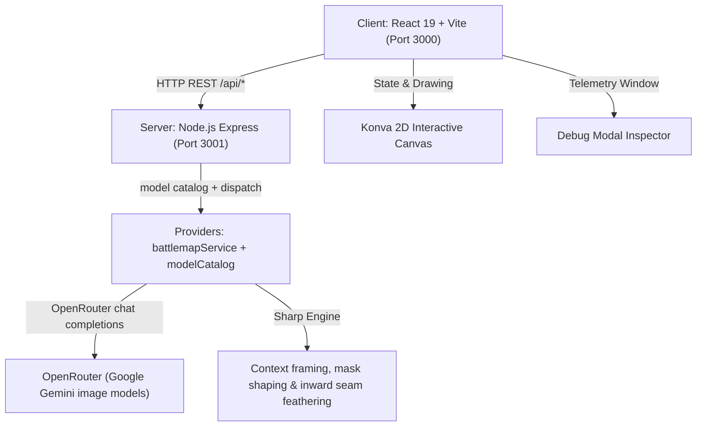

# Client & Server Feature Reference

Implementation contracts for the Node/Express backend and the React client. Root [`AGENTS.md`](../AGENTS.md)
points here; curator features live in [`curator/README.md`](../curator/README.md) and training in
[`training/README.md`](../training/README.md).

## Architecture



The Rust curator service (3002) and the Python training package sit outside this path — see their own READMEs.

## Stack

### Client (`/client`)

- React 19 + Vite 6.
- TailwindCSS v4, dark glassmorphism, design tokens in `src/index.css` (`panel-card`, `btn-*`, `field`,
  `glass-panel`); theme colours are amber for generate, cyan for edit, emerald for expand.
- `react-konva` / `konva` for pan-zoom, 64px grid-snapped region selection and handle resizing.
- `lucide-react`, `canvas-confetti`.

### Server (`/server`)

- Node.js + Express (`PORT=3001`).
- OpenRouter `chat/completions` REST API via `fetch` — the only provider.
- Every map model renders raster pixels directly (the `image` output contract); the reply is the image and is
  resized to the canvas size. There is no SVG contract. Measured behaviour and prices live in
  `services/modelCatalog.js`.
- `sharp` for context framing, binary mask shaping, and 20px inward seam feathering with strict clipping.

### Layout

```
client/src/            React app: components/, services/api.js, utils/format.js
server/                Express app: index.js routes, services/, providers/, test/
curator/               Rust Axum service + embedded UI (see curator/README.md)
training/              Python LoRA training package (see training/README.md)
deploy/                Cluster manifests and rollout docs (see deploy/curator/README.md)
docs/adr/              Architecture decision records
docs/agents/           Issue-tracker and domain-doc conventions
data/                  Reference images and curated assets
```

## Environment & configuration

- Configuration lives in `server/.env`:

  ```env
  PORT=3001
  OPENROUTER_API_KEY=sk-or-v1-...
  ```

  A key supplied through the process environment also satisfies the provider. `/api/health` reports
  `providers.openrouter`.
- The backend authenticates every request centrally with `process.env.OPENROUTER_API_KEY`; `/api/health` is
  the only key-related surface. Client-side key configuration does not exist and does not come back.
- Models are declared in `services/modelCatalog.js` (`MODEL_CATALOG`, exposed via `/api/models`);
  `DEFAULT_MODEL_ID` (`google/gemini-3.1-flash-image`) runs when the client sends no override.

## Feature: initial map generation (`GENERATE`)

- `battlemapService.generateBattlemap()` runs the configured model and assembles the payload from
  `IMAGE_PROMPTS.GENERATE` with architectural 2D plan-view directives and flat poché wall cross-sections.
- When the model is vision-capable, `battlemapService` attaches a curated 1:1 square reference from `data/` via
  `referenceImages.js`, matched on prompt keywords (stone dungeon, tavern, ruins, grand hall), for few-shot
  orthographic perspective conditioning.
- The model returns raster bytes; the provider resizes them to the requested canvas size.
- The configured model is the only map producer. A missing key or unusable model output produces an error with
  `code` + `telemetry` (prompts, per-model attempt trail, raw response, usage/cost); routes forward `400`/`502`/
  `503` and the client raises its failure banner.

## Feature: canvas region forging (`FORGE_REGION`)

- `canvasForge.js#forgeCanvasRegion()` owns focused context framing (default 512px padding around the selection),
  the cyan-tinted guide image, the binary mask, the in-memory render-adapter seam, origin coordinate offsets, and
  inward seam feathering.
- `forgeImageMode` (Studio Settings in the top bar, persisted in `localStorage`, threaded from `App.jsx`):
  - `highlighted-only` (default): one image — the context window with the target region cyan-tinted — paired with
    `IMAGE_PROMPTS.FORGE_REGION_HIGHLIGHTED`. Avoids contradictory multi-image guidance and minimises tokens.
  - `all-three` (legacy): raw context window, cyan guide image and binary mask with `IMAGE_PROMPTS.FORGE_REGION`.
- `compositeRegion()` feathers 20px inward along preserved map edges and clips strictly to the selection box, so
  pixels outside the selection never change.

## Feature: model telemetry inspector (`DebugModal.jsx`)

- Opened by **Debug Logs** in the header. Records structured telemetry for every request, including failures
  (`status: 'failed'`):
  1. system prompt (`IMAGE_PROMPTS`);
  2. user request prompt;
  3. full combined payload sent to the model;
  4. input images (context window, guide, mask);
  5. output images as the model returned them, before resizing or compositing;
  6. raw model response (or a summary of the images received).
- Shows provider, model actually used, token counts and the per-call cost reported by OpenRouter.
- Failures also raise the dismissible rose banner in `App.jsx` (`failure` state) with the error `code`, the
  actionable message, provider/model and the per-model attempt trail; `reportFailure()` writes the same data to the
  debug logs. A request that never reached a model (missing key, unreachable backend) is recorded as such rather
  than with a fabricated prompt.

## Feature: canvas interactions (there is no sidebar)

- **New map** (`PromptHero.jsx`): with no map loaded, only the prompt field and Generate, plus a forging state
  while the model runs.
- **Stage** (`BattlemapCanvas.jsx`): pan (Shift + drag / middle click), zoom 10–500%, auto-fit on load.
- **Region selection** (`ActionModal.jsx` + canvas): right-click drag selects any 64px grid-snapped region — inside
  the map to edit, outside to expand, or spanning both; 8 resize handles and box dragging adjust it.
- **Grid overlay**: a non-interactive, single-draw-call 64px = 5ft grid over the clean ungridded map, toggled from
  the top-right control bar or with `G`.
